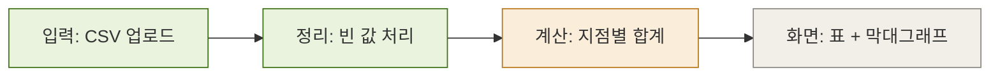

# 구조도 그리기 · 갱신

코드 구조가 아니라 **설계 구조**를 한 장에: 입력 → 처리 → 출력, 그리고 진행 상태.

## 1. 찾기
- `ARCHITECTURE.md`, `docs/*.svg`, README의 ```mermaid 블록을 찾는다. 있으면 그것을 고친다.
- 없고 새로 그려 달라는 요청이면: 기본은 README의 "구조" 칸에 mermaid. 내가 이미지로 원하면 `docs/architecture.svg`.

## 2. 넣을 내용 정하기
- SPEC.md와 DECISIONS.md에서 **확정된 것만** 넣는다. 검토 중이면 "(검토 중)"으로 표시하거나 넣지 않는다.
- 상자 하나 = SPEC 요구 하나 이상과 이어지는 부분. 이어지지 않는 상자는 그리지 않는다.
- 상자 3~7개. 넘으면 묶는다. 시험 채점자가 10초 안에 읽을 수 있게.

## 3. mermaid (기본)

- 상태 색: 구현됨 `done`, 진행 중 `doing`, 미착수 `todo`. 범례는 아래 한 줄로: "초록 = 구현됨 · 주황 = 진행 중 · 회색 = 미착수".
- 상자 글자는 짧게(10자 안팎). 설명은 그림 아래 목록으로.

## 4. SVG (요청할 때만)
- 너비 1000 안팎, 상자 · 화살표 · 범례만. 글꼴 `sans-serif`, 제목 16, 본문 12.
- 색은 위 mermaid와 같은 세 가지. 화살표 marker는 `<defs>`에 하나.
- 줄을 더하면 아래 요소의 y와 상자 높이, `viewBox`를 함께 늘린다 (python으로 범위를 정해 바꾸는 편이 안전).

## 5. 확인
- mermaid: 문법이 깨지지 않았는지 블록을 다시 읽는다 (화살표 `-->`, 따옴표 짝).
- SVG: `python -c "import xml.dom.minidom,sys; xml.dom.minidom.parse(sys.argv[1])" docs/architecture.svg`
- 바뀐 상자 · 줄을 짧게 보고한다. 커밋은 요청받을 때만.
